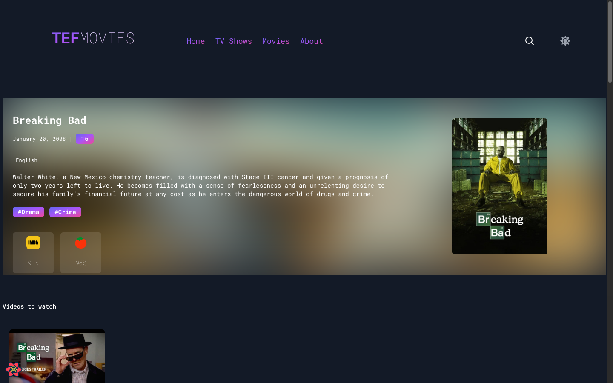
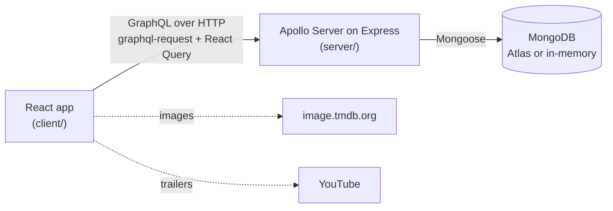

# TEF Movies

A movie and TV show discovery site: browse what's new, watch trailers, explore cast and episode guides, and find where each title is streaming in India.

It's a full-stack JavaScript project with a **React** frontend and a **GraphQL API** (Apollo Server + Express) backed by **MongoDB**.


| Movie details                                | TV show with seasons                            | Mobile                                      |
| -------------------------------------------- | ----------------------------------------------- | ------------------------------------------- |
|  |  |  |

## Features

- **Home, Movies and TV Shows pages**: hero carousel, plus rows for latest releases, latest trailers, IMDb top 10, free titles, and one row per streaming platform (Netflix, Prime Video, JioHotstar).
- **Title pages**: trailers (played in-page), cast and crew with photos, posters, IMDb / Rotten Tomatoes scores, runtime, languages, and "Watch now" cards linking to each platform.
- **Episode guides**: every TV show has season tabs with episode titles and synopses.
- **Discovery**: genre and curated-collection tiles (Christopher Nolan, Indian Cinema, Oscar Winners…), and actor pages listing their movies and shows.
- **Search** by title, genre or cast member across movies and TV shows.
- **Light / dark theme**, remembered between visits.
- **Open GraphQL API**, with a GraphQL Playground for exploring it and admin-protected mutations for managing content.

## Tech stack

| Layer    | Technologies                                                                                                                   |
| -------- | ------------------------------------------------------------------------------------------------------------------------------ |
| Frontend | React 17, React Router 5, React Query 3, graphql-request, Tailwind CSS 3, Framer Motion, react-player                          |
| API      | Node.js, Express 4, Apollo Server 2 (GraphQL)                                                                                  |
| Database | MongoDB with Mongoose 5; [mongodb-memory-server](https://github.com/typegoose/mongodb-memory-server) for zero-setup local runs |

## Architecture



- The client fetches data with `graphql-request` and caches it with React Query. The API URL comes from `REACT_APP_API_URL` ([client/src/config.js](client/src/config.js)).
- The API is a single GraphQL endpoint at `/graphql`. Type definitions and resolvers live in [server/schema.js](server/schema.js), and the Mongoose models in [server/models/](server/models/).
- On startup the API connects to `MONGODB_URI`. When that isn't set, it starts an in-memory MongoDB. If the database is empty, it seeds the sample data from [server/seed/data.json](server/seed/data.json).

```
tef-movies/
├── client/            React app (Create React App + Tailwind)
│   ├── src/pages/       Route-level pages (Home, Movies, Tvshows, OneMovie, Search, …)
│   ├── src/components/  Cards, carousels, detail views
│   └── src/config.js    API URL configuration
├── server/            GraphQL API
│   ├── app.js           Express + Apollo bootstrap, DB connection
│   ├── schema.js        GraphQL type definitions and resolvers
│   ├── models/          Mongoose models
│   └── seed/            Sample data and seeding script
├── docs/              API reference, deployment guide, screenshots
└── render.yaml        Render blueprint for the API
```

## Getting started

**Prerequisites:** Node.js 18 or newer. You don't need MongoDB installed.

```bash
git clone https://github.com/aadarshjr123/tef-movies.git
cd tef-movies
npm run install:all   # installs root, server and client dependencies
npm run dev           # API on :4000, website on :3000
```

Open <http://localhost:3000> for the site, or <http://localhost:4000/graphql> for the GraphQL Playground.

The first run downloads a MongoDB binary for the in-memory database, which takes about a minute once. Without `MONGODB_URI`, data resets every time the API restarts.

### Using a real MongoDB

1. Create a free cluster on [MongoDB Atlas](https://www.mongodb.com/atlas) (or run MongoDB locally).
2. Copy `server/.env.example` to `server/.env` and set `MONGODB_URI`.
3. Run `npm run dev`. An empty database is seeded automatically. To reset it to the sample data later, run `npm run seed`.

### Configuration

| Variable            | Where  | Default                         | Purpose                                                     |
| ------------------- | ------ | ------------------------------- | ----------------------------------------------------------- |
| `MONGODB_URI`       | server | _(in-memory)_                   | MongoDB connection string                                   |
| `PORT`              | server | `4000`                          | API port                                                    |
| `CORS_ORIGINS`      | server | _(any origin)_                  | Comma-separated list of allowed origins                     |
| `ADMIN_TOKEN`       | server | _(unset)_                       | When set, mutations require `Authorization: Bearer <token>` |
| `SEED_ON_START`     | server | `true`                          | Seed sample data when the database is empty                 |
| `REACT_APP_API_URL` | client | `http://localhost:4000/graphql` | GraphQL endpoint the site calls (set at build time)         |

## Documentation

- [GraphQL API reference](docs/API.md): every query and mutation, with examples
- [Deployment guide](docs/DEPLOYMENT.md): MongoDB Atlas + Render (API) + Vercel (site)

## Project history

TEF Movies started in 2022 as four separate repositories, which this repo replaces:

| Original repo                                                        | What it was                    | Now                   |
| -------------------------------------------------------------------- | ------------------------------ | --------------------- |
| [MovieTEF-new](https://github.com/aadarshjr123/MovieTEF-new)         | React frontend                 | `client/`             |
| [TEFBackend](https://github.com/aadarshjr123/TEFBackend)             | GraphQL API (Heroku / Vercel)  | `server/`             |
| [BackendTEF](https://github.com/aadarshjr123/BackendTEF)             | Older copy of the same API     | merged into `server/` |
| [TEFMoviesBackend](https://github.com/aadarshjr123/TEFMoviesBackend) | Same API as a Netlify function | merged into `server/` |

The git history of the frontend and the main API is preserved under `client/` and `server/`. Since then, the following has changed:

- The 2022 deployment had stopped working: the Heroku API, the MongoDB Atlas cluster and the Cloudinary image account were all gone. The API URL and database are now configurable, and a fresh dataset with working image URLs is seeded automatically.
- Credentials are no longer hard-coded; configuration comes from environment variables.
- Mutation resolvers were rewritten. The old ones returned before their database writes finished, and a duplicated `deleteMovie` resolver deleted seasons instead of movies. Search now matches titles, genres and cast, and mutations can be protected with an admin token.
- Unused files and broken build configs were removed, and the About page, streaming-platform names, genre tiles and a few UI bugs were fixed.

## Data and credits

Movie and TV metadata, posters, cast photos and trailer links come from [TMDB](https://www.themoviedb.org/), and streaming availability for India from [JustWatch](https://www.justwatch.com/) via TMDB. This product uses TMDB data but is not endorsed or certified by TMDB. IMDb and Rotten Tomatoes scores in the sample data are approximate snapshots, included for demonstration only.

The API started from Saqib Ameen's [GraphQL-CRUD](https://github.com/saqibameen/GraphQL-CRUD) example.

## License

[MIT](LICENSE) © Aadarsh Sasikumar
