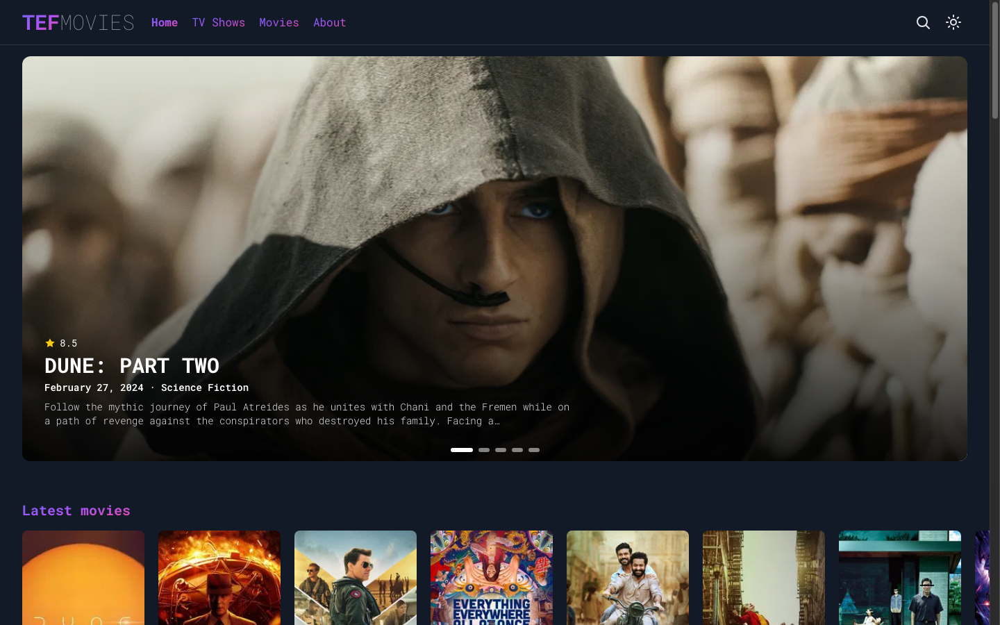
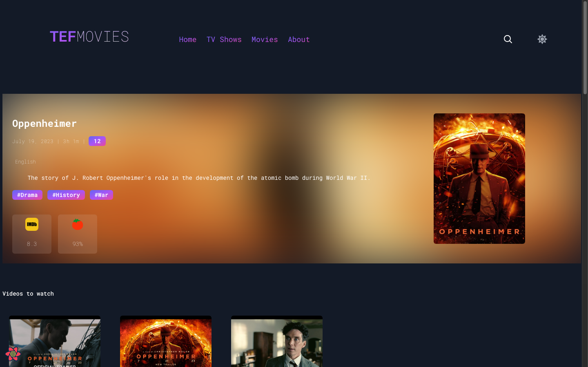
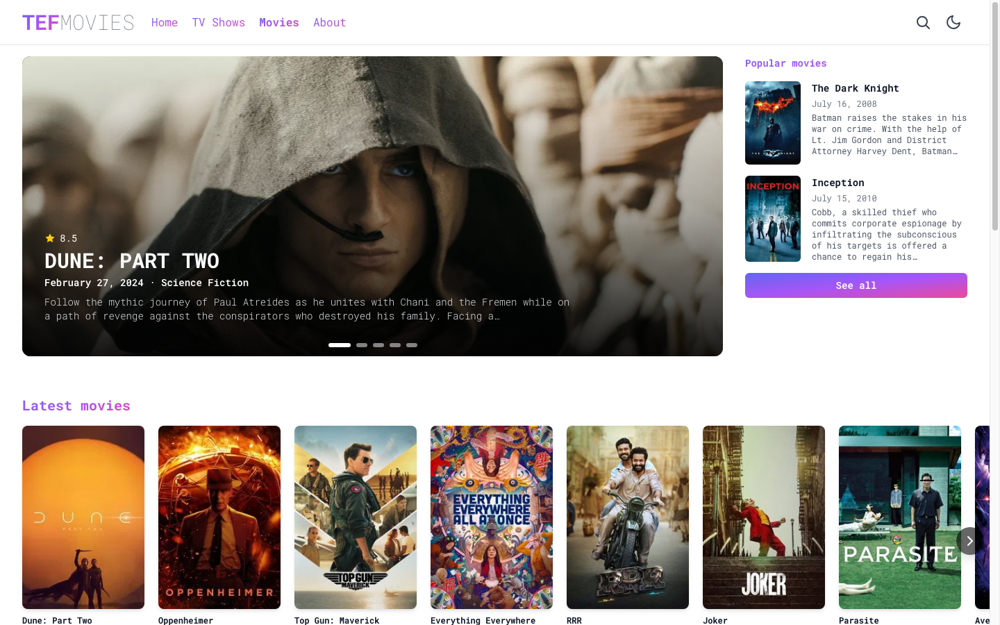
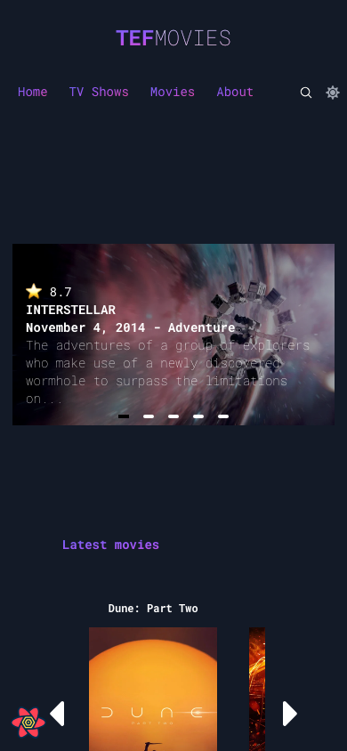
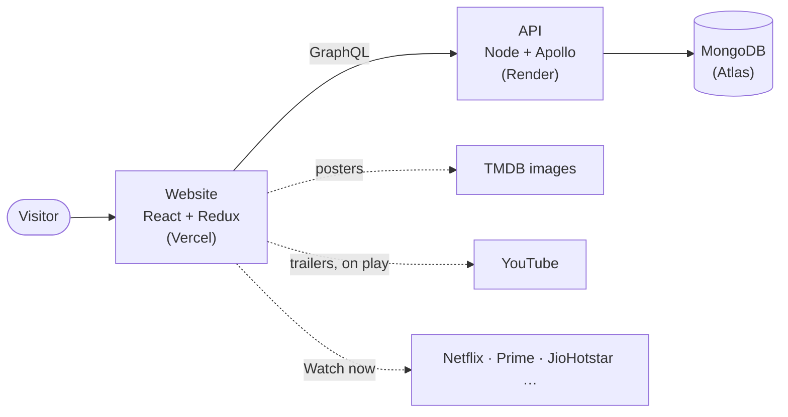

# TEF Movies

A website for deciding what to watch. Browse movies and TV shows, watch trailers, see cast and episode guides, and go straight to the streaming service that has the title in India.



## Why it exists

People spend more time choosing what to watch than they'd like. The information is spread across IMDb, YouTube and five streaming apps. TEF Movies puts it on one page per title and ends with a single "Watch now" link.

It is built like a production product: typed end to end, tested at every level, and measured for performance and accessibility.

## What a visitor can do

|                     |                                                                                                                       |
| ------------------- | --------------------------------------------------------------------------------------------------------------------- |
| **Discover**        | Latest releases, IMDb top 10, free-to-watch titles, and rows per streaming service (Netflix, Prime Video, JioHotstar) |
| **Decide**          | Each title has trailers, cast and crew, ratings, runtime, languages and similar titles                                |
| **Follow a series** | Season-by-season episode guides for TV shows                                                                          |
| **Explore**         | Genres, curated collections and people pages, all linked                                                              |
| **Search**          | By title, genre or cast member; results can be shared by URL                                                          |
| **Watch**           | "Watch now" links to the right service, labelled as stream, rent, buy or free                                         |

It works on phones, tablets and desktops, in light and dark themes.

| Movie page                                | Light theme                                       | Phone                                 |
| ----------------------------------------- | ------------------------------------------------- | ------------------------------------- |
|  |  |  |

## Quality

|                     |                                                                   |
| ------------------- | ----------------------------------------------------------------- |
| Lighthouse (mobile) | Performance 91, Accessibility 100, Best Practices 100, SEO 100    |
| Automated tests     | 137: 51 API, 40 frontend, 46 end-to-end on desktop and mobile     |
| Test coverage       | API 92%, frontend 88%                                             |
| First page load     | ~9 KB of app code, with each page's code loaded only when visited |

## Tech stack

| Layer     | Technology                                            | Why                                                                                           |
| --------- | ----------------------------------------------------- | --------------------------------------------------------------------------------------------- |
| UI        | React 19, TypeScript                                  | The most widely supported UI library; types catch mistakes before users do                    |
| App state | Redux Toolkit, RTK Query                              | One predictable store; built-in caching and loading states instead of hand-written fetch code |
| Routing   | React Router 7                                        | Code splitting per page and data loading that starts before the page code arrives             |
| Styling   | Tailwind CSS                                          | Fast to build with, small CSS output                                                          |
| Build     | Vite                                                  | Fast development and optimised production bundles                                             |
| API       | GraphQL, Apollo Server, Express, Node.js              | Each page requests exactly the data it shows, in one round trip                               |
| Database  | MongoDB, Mongoose                                     | A title with its cast, trailers and offers maps naturally to one document                     |
| Testing   | Vitest, Testing Library, MSW, Playwright, axe-core    | Unit, integration and browser tests, including accessibility checks                           |
| Delivery  | GitHub Actions, Docker, Vercel, Render, MongoDB Atlas | Every change is linted, tested and built automatically                                        |

## Architecture



More detail, with diagrams of the API layers and the frontend state, is in [docs/ARCHITECTURE.md](docs/ARCHITECTURE.md).

## Run it locally

Requires Node.js 20 or newer. A database is optional; without one, the API starts an in-memory database with sample data.

```bash
git clone https://github.com/aadarshjr123/tef-movies.git
cd tef-movies
npm install
npm run dev
```

The website runs at http://localhost:5173 and the GraphQL explorer at http://localhost:4000/graphql.

| Command            | Purpose                                 |
| ------------------ | --------------------------------------- |
| `npm run dev`      | Website and API with hot reload         |
| `npm test`         | Unit and integration tests              |
| `npm run test:e2e` | Browser tests on desktop and mobile     |
| `npm run verify`   | Everything CI runs except browser tests |
| `npm run build`    | Production builds                       |

## Documentation

| Document                             | Contents                                                   |
| ------------------------------------ | ---------------------------------------------------------- |
| [Architecture](docs/ARCHITECTURE.md) | How the system fits together, and why each tool was chosen |
| [API reference](docs/API.md)         | Queries, mutations, errors and limits                      |

## Credits

Movie and TV data, images and trailer links come from [TMDB](https://www.themoviedb.org/), and streaming availability from [JustWatch](https://www.justwatch.com/) via TMDB. This product uses TMDB data but is not endorsed or certified by TMDB. IMDb and Rotten Tomatoes scores in the sample data are approximate.

## License

[MIT](LICENSE) © Aadarsh Sasikumar
