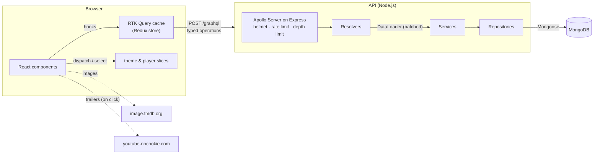
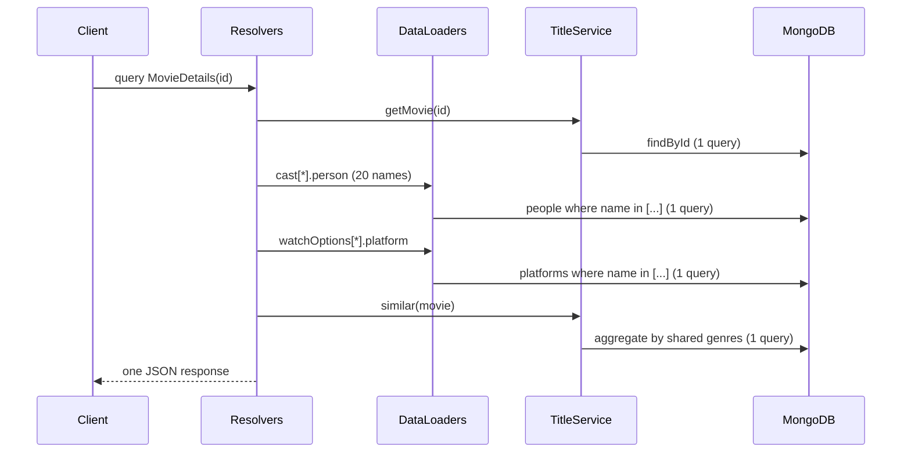

# Architecture

This document explains how TEF Movies is put together and why each tool was chosen. For the API surface, see [API.md](API.md). For what changed from the 2022 version and the measured results, see [AUDIT.md](AUDIT.md).

## System overview



The repository is an npm workspace with two packages and one shared toolchain:

```
tef-movies/
├── server/                 GraphQL API (TypeScript)
│   └── src/
│       ├── config/env.ts         Validated environment (zod)
│       ├── lib/                  Logger, errors, db, generic repository, text helpers
│       ├── modules/
│       │   ├── titles/           Movies, TV shows, seasons: model · repository · service · typeDefs · resolvers · validation
│       │   ├── people/           People (cast, directors, creators)
│       │   └── catalog/          Genres/collections and streaming platforms
│       ├── graphql/              Schema composition, request context, DataLoaders, generated resolver types
│       ├── container.ts          Composition root: wires repositories into services
│       ├── app.ts                Express + Apollo app factory (no listen, so tests can drive it)
│       └── server.ts             Bootstrap: env → DB → seed → listen → graceful shutdown
├── client/                 React app (TypeScript)
│   └── src/
│       ├── app/                  Store, routes, layout, route loaders (prefetch)
│       ├── services/             RTK Query API slice and GraphQL base query
│       ├── features/             titles · people · catalog · search · player · theme · about
│       ├── shared/               UI kit (Img, HorizontalScroller, Modal, Section…), hooks, lib
│       └── graphql/__generated__ Typed operations generated from the server schema
├── e2e/                    Playwright end-to-end tests
├── codegen.ts              GraphQL Code Generator (server resolvers + client operations)
└── .github/workflows/      CI
```

## Backend

### Layers

Each module splits into the same layers, and each layer has one job:

| Layer          | Example               | Responsibility                                                        | Knows about                |
| -------------- | --------------------- | --------------------------------------------------------------------- | -------------------------- |
| **typeDefs**   | `title.typeDefs.ts`   | The GraphQL contract (SDL)                                            | Nothing                    |
| **resolvers**  | `title.resolvers.ts`  | Map GraphQL fields to service calls; enforce auth                     | Services (through context) |
| **service**    | `title.service.ts`    | Business rules: validation, limits, "similar" titles, not-found rules | Repository _interfaces_    |
| **repository** | `title.repository.ts` | Persistence: queries, indexes, mapping documents to domain objects    | Mongoose models            |
| **model**      | `title.model.ts`      | Mongoose schema and indexes                                           | MongoDB                    |

A request for a movie page flows like this:



Without DataLoader, the cast alone would cost about 20 queries (the "N+1 problem"). An integration test (`server/test/integration/api.test.ts`) counts the database queries and fails if person lookups aren't batched.

### SOLID in practice

| Principle                 | Where                                                                                                                                                                                |
| ------------------------- | ------------------------------------------------------------------------------------------------------------------------------------------------------------------------------------ |
| **Single responsibility** | The layers above. For example, `TitleService` has no Mongo code, and resolvers have no business rules.                                                                               |
| **Open/closed**           | New modules plug into `graphql/schema.ts` without editing existing ones (`extend type Query`). `MongoNamedRepository` serves people, platforms and collections without modification. |
| **Liskov substitution**   | `InMemoryTitleRepository` (tests) and `MongoTitleRepository` (production) both satisfy `TitleRepository`, and the service behaves the same with either.                              |
| **Interface segregation** | Services depend on small repository interfaces (`TitleRepository`, `SeasonRepository`, `NamedRepository<T>`), not on Mongoose.                                                       |
| **Dependency inversion**  | `container.ts` is the only file that instantiates concrete repositories. Services receive them through constructors, and resolvers get services from the per-request context.        |

### Schema design

- **`Title` interface** implemented by `Movie` and `TvShow`. Search returns both, and clients pick fields per type. Both kinds live in one MongoDB collection (with `kind`), so search, person and platform queries use one set of indexes.
- **Lookups by `id`**, not by name. The 2022 API looked titles up by name, which breaks on duplicate or renamed titles.
- **Real types instead of string-wrapped arrays.** The 2022 schema had `movieInfo: [{...}]` with one element and `posters: [{ posters: "url" }]`. Now `releaseDate` is an ISO date, ratings are numbers, and offers use a `WatchType` enum.
- **Seasons in their own collection**, so list queries don't drag every episode along. They load through a DataLoader only when requested.
- **Bounded queries.** Every list takes a `limit` clamped to 1–100, and queries deeper than 8 levels are rejected.

### Cross-cutting concerns

| Concern                  | Implementation                                                                                                                          |
| ------------------------ | --------------------------------------------------------------------------------------------------------------------------------------- |
| Configuration            | `config/env.ts` validates env with zod at startup. Production refuses to start without `MONGODB_URI` and a ≥16-character `ADMIN_TOKEN`. |
| Validation               | zod schemas for every mutation input (URLs, ISO dates, rating ranges, YouTube IDs). Errors become `BAD_USER_INPUT` with field paths.    |
| Errors                   | `AppError` (NOT_FOUND, BAD_USER_INPUT, UNAUTHENTICATED) is exposed to clients. Unexpected errors are masked in production.              |
| Auth                     | Mutations require `Authorization: Bearer <ADMIN_TOKEN>`, compared in constant time.                                                     |
| Security headers / abuse | helmet, per-IP rate limiting on `/graphql`, 1 MB body limit, query depth limit, regex-escaped search input.                             |
| Observability            | pino structured JSON logs with request logging (`pino-http`), redacted auth headers, and a `/health` endpoint for the load balancer.    |
| Lifecycle                | Graceful shutdown on SIGTERM: stop accepting requests, drain in-flight ones (Apollo drain plugin), close the DB.                        |
| Performance              | MongoDB indexes for every filter and sort, `.lean()` reads, gzip, a cached CORS preflight (`maxAge`).                                   |

## Frontend

### State: what lives where

| Kind of state                                           | Where                                      | Why                                                                                                       |
| ------------------------------------------------------- | ------------------------------------------ | --------------------------------------------------------------------------------------------------------- |
| **Server data** (titles, people, collections)           | RTK Query cache in Redux                   | Caching, request de-duplication, loading/error flags, refetch and prefetch, with no hand-written reducers |
| **App-wide client state** (theme, playing trailer)      | Redux slices (`themeSlice`, `playerSlice`) | Read and changed by distant components (the header toggle and every trailer thumbnail)                    |
| **URL state** (search query, genre filter)              | React Router search params                 | Shareable, survives reloads, works with back/forward                                                      |
| **Local UI state** (selected season, "read more" modal) | `useState`                                 | Only one component cares; putting it in Redux would add indirection for nothing                           |

Side effects stay out of reducers. The theme's DOM class and `localStorage` write happen in RTK **listener middleware**, so the slice remains a pure function and is trivially testable.

### Data fetching

- One `createApi` slice (`services/api.ts`). Each feature adds its endpoints with `injectEndpoints`, so features own their queries but share one cache and middleware.
- `graphqlBaseQuery` turns transport errors, HTTP errors and GraphQL errors into one `ApiError` shape, so every component handles a single error type.
- **Typed end to end:** operations are written next to the feature (`titles.api.ts`), and GraphQL Code Generator produces their TypeScript types from the server schema. If a query asks for a field the API doesn't have, the build fails.
- **Render as you fetch:** route loaders (`app/prefetch.ts`) start a page's main requests while its JavaScript chunk is still downloading, instead of waiting for the component to mount.
- **Prefetch on intent:** hovering or focusing a title card prefetches its details page.

### Components

There's one component per UI pattern, composed instead of copied:

| Component                          | Replaces (2022)                                    |
| ---------------------------------- | -------------------------------------------------- |
| `TitleCard`                        | 9 near-identical card components                   |
| `HorizontalScroller`               | 32 copy-pasted scroll handlers and refs            |
| `TitleRow` / `CollectionRow`       | Every row's own loading/error/empty handling       |
| `TitleDetailsView`                 | Two 900–1100-line detail components (movie and TV) |
| `KindLandingPage`, `BrowsePage`    | Separate, duplicated Movies and TV Shows pages     |
| `Modal` (native `<dialog>`)        | Hand-rolled overlays without focus management      |
| `TrailerCard` + one `TrailerModal` | A react-player instance embedded per trailer       |

Pages are written once for both kinds of title and configured with a `kind` prop (`KIND` in `features/titles/kinds.ts`). The TV page adds its season guide through `TitleDetailsView`'s `children` slot (open/closed principle), so the shared view knows nothing about seasons.

### Responsive design

- Mobile-first Tailwind breakpoints: grids go from 2 to 7 columns, and the header nav moves to its own row on phones.
- Rows scroll horizontally with scroll snapping on touch devices. Arrow buttons appear only from `md` up and disable at the ends.
- Every image slot has an explicit aspect ratio, so loading images never shift the layout.
- Playwright checks that no page scrolls horizontally on a Pixel 7 viewport. This test caught a real bug where visually hidden text escaped a scroll container and zoomed the whole mobile page out.

### Performance

| Technique                                      | Effect                                                                      |
| ---------------------------------------------- | --------------------------------------------------------------------------- |
| Route-level code splitting (`lazy` routes)     | Pages are 0.5–2.5 KB gzip chunks; the app entry is ~9 KB                    |
| Vendor chunk (React, Router, Redux)            | Cached across deploys                                                       |
| TMDB `srcset` + `sizes`                        | Phones download 300–500 px images instead of 780–1280 px                    |
| Click-to-load YouTube                          | No iframes until the user presses play                                      |
| `fetchpriority="high"` hero image, preconnects | Faster Largest Contentful Paint                                             |
| Inline SVG icons, self-hosted variable font    | Replaced three icon libraries, Lottie animations and 800 KB of unused fonts |
| Route loaders + hover prefetch                 | Data requests start one step earlier                                        |

### Accessibility

Semantic landmarks with a skip link, one `h1` per page, and section headings labelling their regions. Native `<dialog>` for modals (focus trap, Escape). Visible focus rings, `aria-pressed` and `aria-current` where state matters, 24 px touch targets, reduced-motion support (the carousel stops auto-advancing), and colours chosen for 4.5:1 contrast in both themes. axe-core runs in the e2e suite against both themes.

## Testing strategy

```
          ▲  e2e (Playwright, 23 tests × desktop & mobile)      user journeys, layout overflow, axe
         ▲▲▲  integration (Vitest)                              API over HTTP + real MongoDB;
        ▲▲▲▲▲                                                   pages with real store/router + MSW
       ▲▲▲▲▲▲▲  unit (Vitest)                                   services with in-memory repos, slices,
                                                                base query, formatters, components
```

| Level                | Tooling                                                          | What it proves                                                                                                               |
| -------------------- | ---------------------------------------------------------------- | ---------------------------------------------------------------------------------------------------------------------------- |
| Backend unit         | Vitest + in-memory repositories (`server/test/helpers/fakes.ts`) | Business rules without a database. Possible because services depend on interfaces.                                           |
| Backend integration  | Vitest + supertest + mongodb-memory-server                       | The real HTTP stack, schema, resolvers, Mongo queries, auth, validation errors, depth limit, DataLoader batching             |
| Frontend unit        | Vitest + Testing Library                                         | Slices, listener middleware, base query error mapping, formatters, components by role                                        |
| Frontend integration | Vitest + Testing Library + MSW                                   | Whole pages through the real router, store and RTK Query; MSW answers at the network layer                                   |
| End-to-end           | Playwright + axe-core                                            | The production build against the real API on desktop and mobile; no horizontal overflow; no serious accessibility violations |

Tests query by role and accessible name (as users and assistive technology do), not by CSS classes, so they survive refactors and double as accessibility checks.

## Tooling decisions

| Tool                                | Why                                                                                                                                 | Alternatives considered                                                                        |
| ----------------------------------- | ----------------------------------------------------------------------------------------------------------------------------------- | ---------------------------------------------------------------------------------------------- |
| **TypeScript** (strict, both sides) | Catches contract mistakes at compile time; makes refactors safe                                                                     | JavaScript with JSDoc: weaker guarantees                                                       |
| **GraphQL** (kept from 2022)        | Pages need differently shaped data (cards vs. details); one round trip per page; typed schema                                       | REST: many endpoints or over-fetching per page                                                 |
| **Apollo Server 5 + Express 5**     | Maintained (v2 is end-of-life), standard plugins (drain, landing page), Express middleware ecosystem (helmet, rate limit)           | GraphQL Yoga: equally good; Apollo kept for continuity                                         |
| **MongoDB + Mongoose 8** (kept)     | Document model fits titles with nested cast/offers; schema validation and indexes in Mongoose                                       | PostgreSQL: better for relational queries, but a migration with no user-facing benefit here    |
| **DataLoader**                      | The standard fix for GraphQL N+1 queries, scoped per request                                                                        | Mongo `$lookup` in every list query: couples queries to the response shape                     |
| **zod**                             | One schema gives runtime validation and TypeScript types (env and inputs)                                                           | Joi/yup: no type inference of the same quality                                                 |
| **pino**                            | Fast structured JSON logs for log aggregation; pretty output in development                                                         | winston: slower, more configuration                                                            |
| **GraphQL Code Generator**          | Single source of truth: server SDL → typed resolvers _and_ typed client operations                                                  | Hand-written types: drift silently                                                             |
| **React 19 + Vite**                 | Current React; Vite gives instant dev server and Rollup production builds (Create React App is deprecated)                          | Next.js: SSR not needed for this app; would add a server to run                                |
| **Redux Toolkit + RTK Query**       | Predictable global state with DevTools; RTK Query removes hand-written fetching/caching code; one store for server and client state | React Query + Zustand: two libraries for the same job; Context: no caching, re-render pitfalls |
| **React Router 7 (data router)**    | Lazy routes (code splitting), loaders for prefetching, error boundaries per route                                                   | TanStack Router: good, but less familiar to most teams                                         |
| **Tailwind CSS** (kept)             | Already used by the 2022 design; utility classes keep styles next to markup; tiny CSS output                                        | CSS Modules: more files, same result                                                           |
| **Vitest**                          | Same config and transforms as Vite; fast; Jest-compatible API                                                                       | Jest: separate Babel/TS setup                                                                  |
| **Testing Library**                 | Tests interact the way users do (roles, labels)                                                                                     | Enzyme: tests implementation details; unmaintained                                             |
| **MSW**                             | Mocks at the network layer, so tests run the real data-fetching code                                                                | Mocking hooks: skips the code most likely to break                                             |
| **Playwright + axe-core**           | Real browsers, mobile emulation, traces on failure; automated accessibility checks                                                  | Cypress: weaker multi-viewport support, paid parallelism                                       |
| **ESLint + Prettier**               | Consistent code and caught bugs (hooks rules, jsx-a11y) with no style debates                                                       | —                                                                                              |
| **GitHub Actions**                  | Runs lint, types, tests, build and e2e on every PR, and checks generated code is committed                                          | —                                                                                              |
| **Docker + docker-compose**         | Same API image locally and in production; one command for a production-like stack                                                   | Platform buildpacks: less portable                                                             |

## Trade-offs and next steps

- **Client-side rendering.** The site is a SPA, so first paint waits for JavaScript. If SEO for title pages became important, the next step would be server rendering (React Router framework mode or Next.js) reusing the same RTK Query endpoints.
- **Pagination.** Lists are capped at 100. A larger catalog needs cursor-based pagination (`movies(after:, first:)`) and infinite scrolling.
- **Search.** Regex matching is fine for a small catalog. At scale it should use Atlas Search or Elasticsearch for relevance ranking and typo tolerance.
- **Caching.** Responses could carry `Cache-Control` hints with a CDN in front of the API, or use persisted queries to make GET requests cacheable.
- **Admin UI.** Mutations exist and are protected, but there's no admin screen yet.
