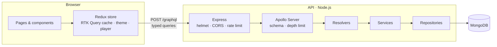
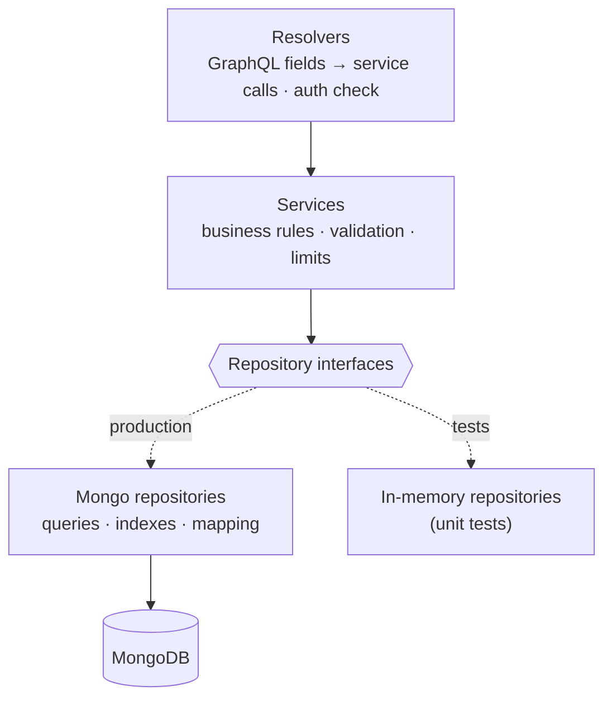
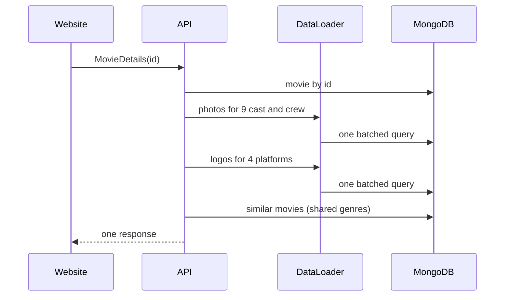
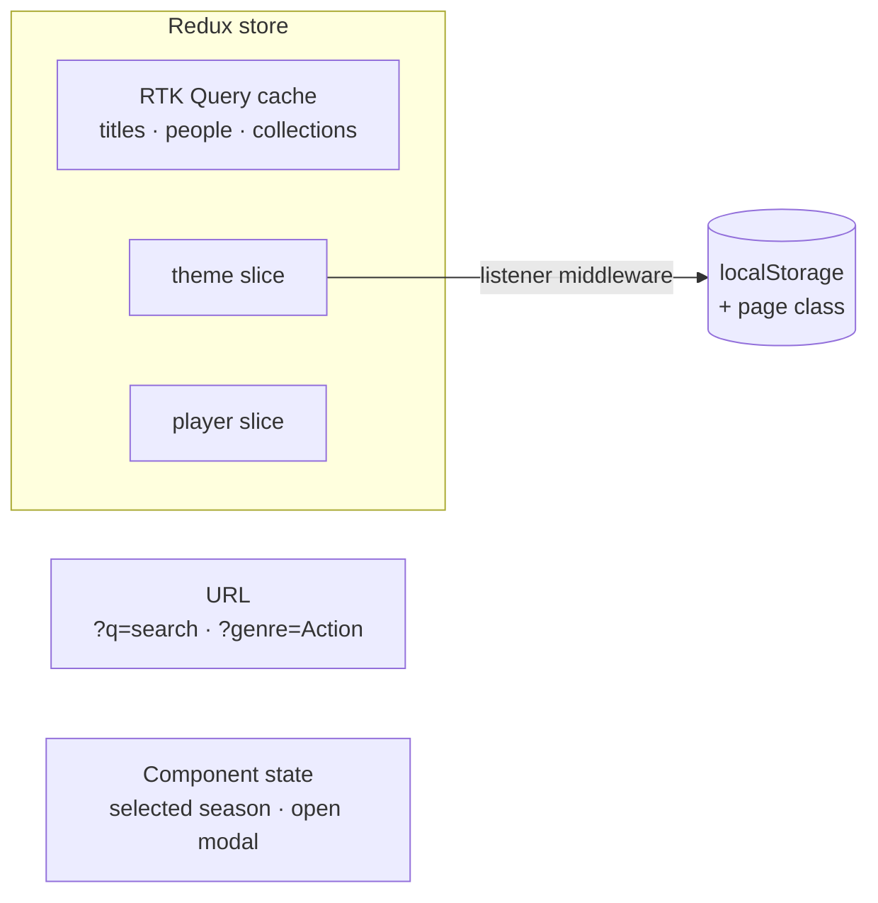
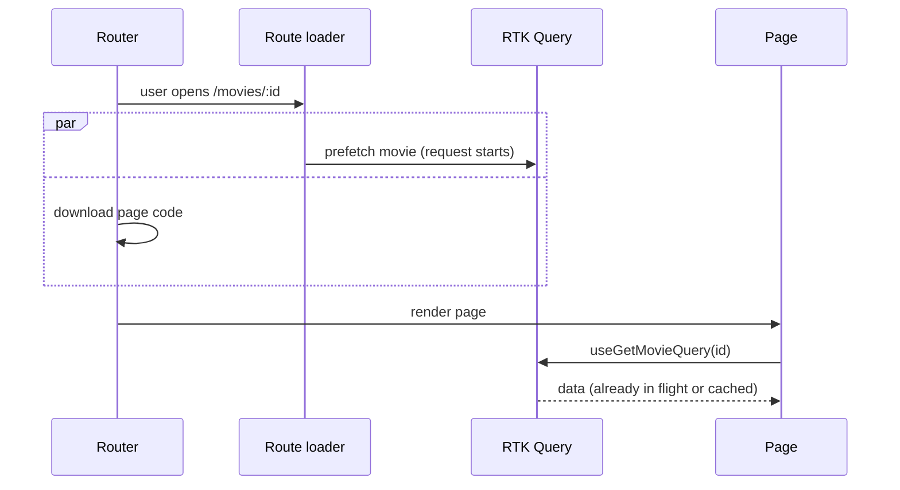
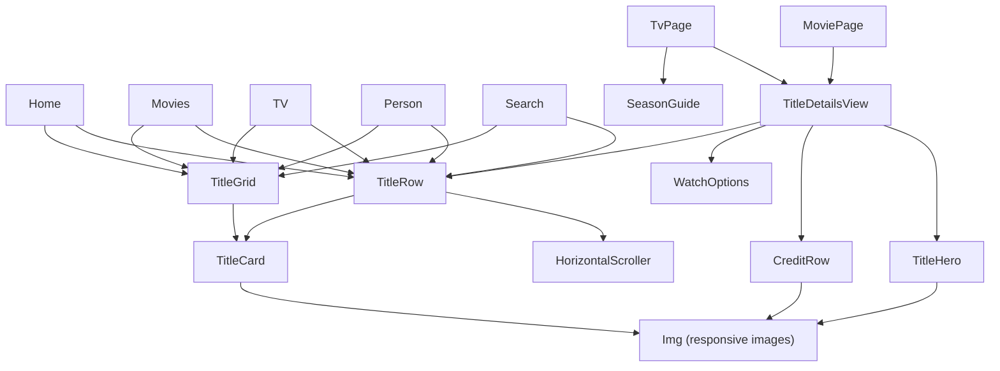

# Architecture

## 1. System



| Part                | Hosted on                      | Responsibility                                  |
| ------------------- | ------------------------------ | ----------------------------------------------- |
| Website             | Vercel (static files on a CDN) | Everything the visitor sees                     |
| API                 | Render                         | Business rules, validation, data access         |
| Database            | MongoDB Atlas                  | Titles, seasons, people, platforms, collections |
| Images and trailers | TMDB, YouTube                  | Loaded directly by the browser                  |

## 2. Repository map

```
tef-movies/
├── client/                 Website
│   └── src/
│       ├── app/            store · routes · layout · route loaders
│       ├── services/       API slice · GraphQL base query · retry
│       ├── features/       titles · people · catalog · search · player · theme · about
│       ├── shared/         UI kit · hooks · formatting and image helpers
│       └── graphql/        generated query types
├── server/                 API
│   └── src/
│       ├── modules/        titles · people · catalog  (each: model → repository → service → resolvers)
│       ├── graphql/        schema assembly · request context · DataLoaders · generated resolver types
│       ├── lib/            errors · logging · database · shared repository
│       ├── config/         validated environment
│       ├── container.ts    wires repositories into services
│       └── server.ts       start-up and graceful shutdown
├── e2e/                    browser tests
└── codegen.ts              one schema → types for API and website
```

## 3. API

### Layers



Each layer has one job, and services only know the interfaces. `container.ts` is the one place that picks the Mongo implementation, so unit tests swap in in-memory versions without a database.

| SOLID principle       | Where it shows                                                                                                                         |
| --------------------- | -------------------------------------------------------------------------------------------------------------------------------------- |
| Single responsibility | Resolvers, services and repositories each do one thing                                                                                 |
| Open/closed           | A new module adds its own schema and resolvers without editing others; one generic repository serves people, platforms and collections |
| Liskov substitution   | Mongo and in-memory repositories are interchangeable                                                                                   |
| Interface segregation | Services depend on small repository interfaces, not on Mongoose                                                                        |
| Dependency inversion  | Concrete classes are created only in `container.ts`                                                                                    |

### One request



Without batching, a title page costs about 15 queries. With DataLoader it costs 4. An integration test fails if batching breaks.

### Safety

| Concern       | How it is handled                                                                         |
| ------------- | ----------------------------------------------------------------------------------------- |
| Configuration | Validated at start-up; production refuses to start without a database URL and admin token |
| Input         | Every mutation input is validated (URLs, dates, rating ranges, YouTube IDs)               |
| Writes        | Mutations require an admin token                                                          |
| Abuse         | Rate limiting, query depth limit, body size limit, escaped search input, security headers |
| Errors        | Clear codes for expected errors; internal details hidden in production                    |
| Operations    | Structured logs, health endpoint, graceful shutdown                                       |

## 4. Website

### Where state lives



| State                       | Lives in        | Reason                                                         |
| --------------------------- | --------------- | -------------------------------------------------------------- |
| Server data                 | RTK Query cache | Caching, de-duplication, loading and error states, prefetching |
| Theme, playing trailer      | Redux slices    | Used by components far apart in the tree                       |
| Search text, filters        | URL             | Shareable, survives refresh and the back button                |
| Selected season, open modal | Component state | Only one component cares                                       |

### How a page gets its data



Hovering a title card prefetches its page too, so most clicks open instantly. If the API is waking up, network failures are retried for about 70 seconds while the page shows loading placeholders.

### Components

One component per pattern, reused everywhere:



Movie and TV pages share one layout. The TV page adds its season guide through a slot, so the shared layout knows nothing about seasons.

## 5. Performance

| Technique                         | Result                                                |
| --------------------------------- | ----------------------------------------------------- |
| Code split per page               | ~9 KB of app code on first load; each page 0.5–2.5 KB |
| Separate framework chunk          | React and Redux (131 KB) stay cached across deploys   |
| Responsive images                 | Phones download 300–500 px images, not 780–1280 px    |
| Trailers load on play             | No video players until someone presses play           |
| Data starts with the page code    | Route loaders and hover prefetching                   |
| Reserved image space              | Content doesn't jump as images arrive                 |
| Server-side filtering and indexes | Pages receive only what they show                     |

Lighthouse on a mobile profile: performance 91, accessibility 100.

## 6. Testing

| Level            | Tools                   | Covers                                                                                                |
| ---------------- | ----------------------- | ----------------------------------------------------------------------------------------------------- |
| End-to-end · 46  | Playwright, axe-core    | Real browser on desktop and phone: user journeys, no sideways scrolling, accessibility in both themes |
| Integration · 29 | Vitest, supertest, MSW  | API over HTTP against a real MongoDB; whole pages with the real store and router                      |
| Unit · 62        | Vitest, Testing Library | Business rules, Redux slices, error handling, components                                              |

Tests find elements by role and label, the way screen readers do, so they survive refactors and double as accessibility checks.

## 7. Why these tools

| Tool                           | Chosen because                                                               | Alternative considered                              |
| ------------------------------ | ---------------------------------------------------------------------------- | --------------------------------------------------- |
| TypeScript                     | Mistakes are caught while writing code, and refactors are safe               | JavaScript: errors surface in production            |
| React 19                       | Largest ecosystem and hiring pool                                            | Vue, Svelte: smaller ecosystems                     |
| Redux Toolkit + RTK Query      | One store for server and app state, with caching built in                    | TanStack Query + Zustand: two libraries for one job |
| React Router 7                 | Per-page code splitting, loaders, per-route error pages                      | TanStack Router: less widely known                  |
| Vite                           | Instant dev server and optimised production builds                           | Next.js: server rendering not needed here           |
| Tailwind CSS                   | Quick to build with, tiny CSS output                                         | CSS Modules: more files, same result                |
| GraphQL                        | Different pages need differently shaped data, in one request                 | REST: many endpoints or over-fetching               |
| Apollo Server 5 + Express 5    | Supported versions with standard security middleware                         | GraphQL Yoga: equally valid                         |
| MongoDB + Mongoose             | Titles are naturally documents                                               | PostgreSQL: a migration with no user benefit        |
| DataLoader                     | Standard fix for repeated per-item queries                                   | Database joins in every query                       |
| zod                            | Validation and TypeScript types from one definition                          | Joi, yup: weaker type inference                     |
| GraphQL Code Generator         | API and website types come from one schema                                   | Hand-written types drift                            |
| Vitest + Testing Library + MSW | Same setup as the build; tests behave like users; mocks at the network level | Jest, Enzyme                                        |
| Playwright + axe-core          | Real browsers, phone emulation, automated accessibility                      | Cypress                                             |
| GitHub Actions                 | Every change is linted, type-checked, tested and built                       | Manual checks                                       |

## 8. Known limits

| Limit                                               | Next step if it mattered                                   |
| --------------------------------------------------- | ---------------------------------------------------------- |
| Rendered in the browser, so search engines see less | Server rendering (React Router framework mode or Next.js)  |
| Lists stop at 100 items                             | Cursor-based pagination                                    |
| Search is a simple text match                       | A search engine (Atlas Search, Elasticsearch)              |
| No admin screen                                     | The protected mutations already exist; a UI could be added |
