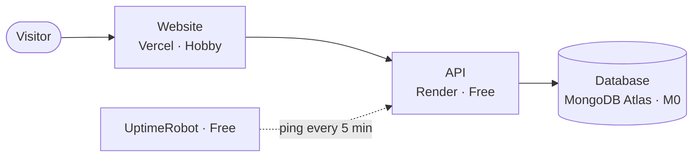

# Deployment: free hosting

This guide puts TEF Movies online at no cost, permanently. It takes about 30 minutes.



| Service                                        | Plan                             | Cost | Card needed | If a limit is reached                                          |
| ---------------------------------------------- | -------------------------------- | ---- | ----------- | -------------------------------------------------------------- |
| [Vercel](https://vercel.com)                   | Hobby                            | $0   | No          | Paused until the next 30-day period; never billed              |
| [Render](https://render.com)                   | Free web service                 | $0   | No          | Suspended until next month; never billed without a card        |
| [MongoDB Atlas](https://www.mongodb.com/atlas) | M0 cluster (512 MB)              | $0   | No          | Writes stop at the storage limit; this project uses about 1 MB |
| [UptimeRobot](https://uptimerobot.com)         | Free (50 monitors, 5-min checks) | $0   | No          | —                                                              |

## Rules that keep it free

1. **Never add a payment card** to Vercel, Render or Atlas. Without one, nothing can be billed; at worst a service pauses.
2. **Keep only one free web service** in the Render workspace. Render gives 750 free hours per month, and one service running all month uses about 744.
3. **Use the free subdomains** (`*.vercel.app`, `*.onrender.com`). A custom domain is optional and is the only thing here that costs money.
4. **Keep it a personal showcase.** Vercel's Hobby plan is for non-commercial use.

## Before you start

- The code pushed to a GitHub repository (all three services deploy from GitHub)
- A GitHub account to sign in to each service

---

## Step 1: Database (MongoDB Atlas)

1. Sign up at <https://www.mongodb.com/cloud/atlas/register>.
2. Create a cluster: choose **M0 / Free**, provider **AWS**, region **Singapore (ap-southeast-1)** (the closest free region to the API host below). Name it `tef-movies`.
3. **Database Access → Add New Database User**: username `tef-api`, click **Autogenerate Secure Password**, and copy the password. Role: **Read and write to any database**.
4. **Network Access → Add IP Address → Allow Access from Anywhere** (`0.0.0.0/0`). Render's free plan has no fixed IP address, so this is required; the password still protects the database.
5. **Database → Connect → Drivers** and copy the connection string. Insert the password, and add the database name `tefmovies` before the `?`:

   ```
   mongodb+srv://tef-api:<password>@tef-movies.xxxxx.mongodb.net/tefmovies?retryWrites=true&w=majority
   ```

Keep this string private. You don't need to load any data: the API fills an empty database with the sample data on its first start.

## Step 2: API (Render)

1. Sign up at <https://render.com> with GitHub.
2. **New → Blueprint**, and select the repository. Render reads [`render.yaml`](../render.yaml), which defines a free Node web service in Singapore.
3. When asked for environment values:
   - `MONGODB_URI`: the connection string from step 1
   - `CORS_ORIGINS`: leave empty for now
   - `ADMIN_TOKEN` is generated automatically
4. **Apply**. The first build takes a few minutes.
5. Open `https://<your-service>.onrender.com/health`. It should show `{"ok":true}`.

Note the API address: `https://<your-service>.onrender.com/graphql`.

The service refuses to start if `MONGODB_URI` or `ADMIN_TOKEN` is missing, so a configuration mistake shows up immediately in the Render logs instead of as a broken site.

## Step 3: Website (Vercel)

1. Sign up at <https://vercel.com> with GitHub, on the **Hobby** plan.
2. **Add New → Project**, and import the repository.
3. Set **Root Directory** to `client`. Vercel detects Vite; leave the build settings as they are.
4. Under **Environment Variables**, add `VITE_API_URL` = `https://<your-service>.onrender.com/graphql`.
5. **Deploy**.

The site is now at `https://<your-project>.vercel.app`. [`client/vercel.json`](../client/vercel.json) makes page refreshes work on any URL, and caches the hashed asset files for a year.

`VITE_API_URL` is built into the site, so redeploy on Vercel whenever you change it.

## Step 4: Allow the website to call the API

In Render, open the service → **Environment**, set `CORS_ORIGINS` to the Vercel address (for example `https://tef-movies.vercel.app`, with no trailing slash), and save. Render restarts the service.

To allow Vercel preview deployments too, list several addresses separated by commas.

## Step 5: Keep the API awake (UptimeRobot)

Free Render services stop after 15 minutes without traffic and take about a minute to start again. A monitor that calls the API every 5 minutes keeps it running, and also emails you if the site goes down.

1. Sign up at <https://uptimerobot.com> (free, no card).
2. **New monitor**: type **HTTP(s)**, URL `https://<your-service>.onrender.com/health`, interval **5 minutes**.
3. Save.

If the API ever does fall asleep, the website retries for about 70 seconds while showing loading placeholders, so visitors see a slow first load rather than an error.

## Step 6: Check it

- [ ] The home page shows posters and rows
- [ ] A movie page shows cast photos and trailers, and a trailer plays
- [ ] Search for "nolan" returns results
- [ ] Refreshing a page such as `/movies` works
- [ ] It looks right on a phone
- [ ] UptimeRobot shows the monitor as up

## Updating the site

Push to the `main` branch. Vercel and Render both rebuild automatically. GitHub Actions runs the checks and tests on every push and pull request.

Render free builds come out of a monthly build-minute allowance. Normal use stays well inside it, and without a card, running out only pauses builds until the next month.

## Environment variables

| Variable                   | Set on | Value                                                             |
| -------------------------- | ------ | ----------------------------------------------------------------- |
| `MONGODB_URI`              | Render | Atlas connection string                                           |
| `ADMIN_TOKEN`              | Render | Generated by Render; needed only for data changes through the API |
| `CORS_ORIGINS`             | Render | The Vercel address                                                |
| `NODE_ENV`, `NODE_VERSION` | Render | Set by `render.yaml`                                              |
| `VITE_API_URL`             | Vercel | The Render API address ending in `/graphql`                       |

Optional API settings: `PORT`, `SEED_ON_START` (default `true`), `LOG_LEVEL` (default `info`), `RATE_LIMIT_PER_MINUTE` (default `300`).

## Troubleshooting

| Symptom                                         | Cause and fix                                                                                                                     |
| ----------------------------------------------- | --------------------------------------------------------------------------------------------------------------------------------- |
| Rows show "Couldn't reach the server"           | `VITE_API_URL` is wrong (fix it and redeploy on Vercel), or the API is down (check `/health` and the Render logs)                 |
| Browser console shows a CORS error              | `CORS_ORIGINS` on Render doesn't exactly match the site address                                                                   |
| Render log: "Invalid environment configuration" | A required variable is missing; the log names it                                                                                  |
| Render log: `MongooseServerSelectionError`      | Atlas network access isn't set to `0.0.0.0/0`, or the password in `MONGODB_URI` is wrong (special characters must be URL-encoded) |
| First visit after a quiet period is slow        | The API was asleep; check the UptimeRobot monitor is active                                                                       |
| Vercel build fails                              | Check that Root Directory is `client`                                                                                             |

---

## Running the production setup locally (optional)

`docker compose up --build` starts MongoDB, the API image and the website served by nginx, at <http://localhost:8080>. It needs Docker Desktop. The images in [`server/Dockerfile`](../server/Dockerfile) and [`client/Dockerfile`](../client/Dockerfile) can also be deployed to any container host.
